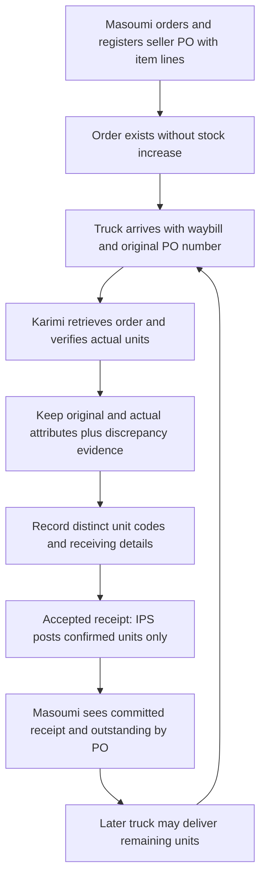

# Draft business requirements — purchase to confirmed warehouse intake

**Step 1 only; draft for Owner review.** [SRC-004](../00-governance/team-answers/FACTORY_PURCHASE_RECEIVING_2026-10-20.md)
records actual Owner-confirmed investigation findings. Those business facts are
authoritative inputs. This derived document is not yet an Owner-approved
requirements artifact, an architectural reconciliation, implementation permission,
factory UAT or production acceptance. It does not accept/push earlier commits on
the Owner's behalf. Eleven accepted backend capabilities remain; no twelfth is delivered.

Bounded goal: accurately register ordered raw materials, receive actual units
across separate arrivals, preserve discrepancies/origins and provide purchasing
visibility, without treating an order or outstanding material as stock. Users:
Ms. Masoumi (ordering/registration and receiving visibility) and Mr. Karimi
(arrival/physical verification/receiving). Names express factory duties, not software
grant checks. Prerequisites remain personal Identity, atomic command/audit and sole IPS.

This task's execution plan: record source and exact fields; model the AS-IS process,
weights and relationships; assign traceable requirements; compare actual accepted
behavior and reassess old F01–F08; independently review, validate and commit docs;
stop for Owner review before Step 2. Excluded now: code, APIs/contracts, SQL,
runtime permissions, product gate/unlock changes, implementation planning beyond
preliminary impacts, device/ticket integration, QC, monetary Finance, UI and cutover.

## Evidence classes and companion documents

- **FACT** = latest confirmed business input in SRC-004; numbered requirements below.
- **ARCH** = existing accepted architecture, still binding until explicitly reconciled.
- **PROPOSAL** = conceptual placement/possible boundary only, not approved schema/design.
- **OPEN/CONFLICT** = missing policy or architecture reconciliation; not a guessed default.

The [exact 23-field dictionary](PURCHASE_RECEIVING_FIELD_REGISTER.md) owns field
requiredness/actor/stage and proposed levels. The [trace matrix](PURCHASE_RECEIVING_REQUIREMENTS_TRACE.md)
covers every field and rule; [preliminary impacts/questions](PURCHASE_RECEIVING_RECONCILIATION.md)
separate confirmed answers from real decisions. No old command/permission contract
is amended by these requirements IDs.

## End-to-end AS-IS process

| Stage | Factory actor/action | Information and transition | Constraint |
| --- | --- | --- | --- |
| A — order | Ms. Masoumi orders raw materials from seller, obtains seller PO number and registers order/date, all lines/specifications, per-unit W1 and count | Ordered intent exists before all/any goods arrive; one order has multiple lines | No inventory increase; optional item number does not remove line identity |
| B — arrival/lookup | Driver provides this arrival's waybill; Mr. Karimi reads and enters its original seller PO number | Retrieve the registered order and show ordered lines/specifications, with prior receiving progress | Different trucks/waybills can retain the same PO number; not a duplicate merely for that reason |
| C — verification | Mr. Karimi compares actual truck goods to ordered items and confirms only the physical units received now | Identify line and each physical unit; record actual attributes independently of original order values | Not-yet-delivered units remain outstanding; partial delivery alone is not a mismatch |
| C — mismatch evidence | Mr. Karimi records differing confirmed attributes | Preserve original and actual values, affected line/unit and arrival/receipt, trusted actor and explicit discrepancy indication | Accepted actual physical values govern inventory record; no automatic approval/rejection of exceptions or QC gate |
| D — receiving details | Mr. Karimi enters the 11 receiving fields at their relevant stage | Distinct physical Internal System Code; existing warehouse receipt reference; mandatory W2 from waybill; optional full-consignment W3 | No generated business warehouse receipt reference, W3 requirement or per-unit W3 allocation |
| D — confirmation/stock | Confirm physically received units and completed receiving information; accepted receipt invokes existing inventory-posting mechanism | Stock kg is sum of accepted per-unit W1 for the confirmed units; retain each unit's order/line/arrival/waybill/receipt origin | Only IPS posts; retain transaction/idempotency/current authority/audit; no undelivered units or unconfirmed receipt exposure as stock |
| E — purchasing visibility | After successful receiving/stock commit, Ms. Masoumi reviews by original order number | Ordered lines, actual received units/quantities, each arrival/receipt, outstanding, mismatches and confirmed intake | No ordered-only goods shown as received; required future user workflow, no browser implementation claimed |
| Later arrivals | Repeat B–E against the same order, confirming newly arriving units only | Preserve separate arrival/waybill evidence and cumulative line progress | No single-delivery assumption, inferred order closure, automatic remainder disposal or extra-unit acceptance |

The diagram describes observed business transitions, not approved new document
state enums, a screen flow, shipment delivery or exception/remediation authority.

## Weight and quantity semantics

| Concept | Confirmed source/grain | Use |
| --- | --- | --- |
| W1 / field 15 | Ms. Masoumi's weight for one physical unit; separately accepted/confirmed per-unit value with original preserved | Basis for that physically received unit's inventory kg. No independent unit weighing at arrival. Changed W1 provenance/authority remains a reconciliation item |
| W2 / field 21 | Mr. Karimi transcribes origin net from this truck/waybill for its whole consignment | Mandatory arrival evidence, never the total of a multi-truck PO and never a per-unit allocation source |
| W3 / field 22 | Mr. Karimi records optional factory-weighbridge net of this full arrival | Optional aggregate evidence; never replaces W1 or is automatically distributed to Units |
| Field 16 and delivery counts | Ordered physical-unit count by line; current-arrival and cumulative confirmed counts; remaining outstanding | Purchase/receiving progress, not a parallel stock-UOM ledger or permission to post undelivered units |

Preserve W1, W2, W3 and inventory effects independently. No aggregate-equality
acceptance condition, automatic tolerance, rounding, loss, Scrap/Residual, rejection,
financial or corrective effect is defined. OQ-006 fulfillment tolerance cannot be
reused as a weighing policy. Existing exact whole-kg stock arithmetic remains ARCH;
the provenance conflict with “measured kg” is explicit in the reconciliation page.

For an ordinary delivery not exceeding the order, outstanding unit count is ordered
count less cumulative confirmed units. Keep current-arrival count separately and
do not add it twice after commit/replay. Excess/returned/rejected/cancelled quantities
need policy; do not clamp a negative remainder or silently close outstanding units.

Illustrative only: 5 units × 2,000 kg W1 = 10,000 kg ordered. Confirming 3 units at
that accepted W1 posts 6,000 kg across those three units; 2 remain outstanding.
This is not a real record, a consignment-weight distribution or evidence that every
unit on every actual order has the same accepted weight after verification.

## Numbered confirmed business requirements — FACT

Each ID is stable for later implementation/test traceability, not a TEST catalogue.

| ID | Confirmed business requirement | Source section |
| --- | --- | --- |
| REQ-INBOUND-001 | Ms. Masoumi orders then registers the seller-provided PO reference and registration date before goods necessarily arrive | Owner §1 A |
| REQ-INBOUND-002 | One PO supports multiple item lines, ordered specifications, per-unit W1 and ordered physical-unit count | Owner §1 A; §2.1 |
| REQ-INBOUND-003 | Order registration alone must not increase inventory | Owner §1 A |
| REQ-INBOUND-004 | A PO may arrive across multiple trucks/arrivals with distinct waybills retaining the original PO reference | Owner §1 B; §6 |
| REQ-INBOUND-005 | Mr. Karimi uses the waybill PO number to retrieve original order/lines/specifications and physically verify goods | Owner §1 B |
| REQ-INBOUND-006 | Confirm only actual physical units received on the current arrival; undelivered units stay outstanding | Owner §1 B/D; §6 |
| REQ-INBOUND-007 | Keep ordered, prior/cumulative confirmed, current-arrival confirmed and outstanding counts distinguishable per line; no single-delivery-only model | Owner §6 |
| REQ-INBOUND-008 | Mr. Karimi records actual differing attributes; accepted confirmed values govern the received physical inventory record | Owner §1 C; §7 |
| REQ-INBOUND-009 | Preserve original ordered values and actual values with explicit persistent discrepancy indication, affected line/unit, trusted receiver and arrival/receipt linkage | Owner §1 C; §7 |
| REQ-INBOUND-010 | Partial/not-yet delivery is not itself a specification discrepancy | Owner §1 C; §7 |
| REQ-INBOUND-011 | Every received physical unit has a distinct physically associated Internal System Code and independent traceability | Owner §1 D; §4 |
| REQ-INBOUND-012 | Each received unit retains PO, line, arrival/waybill and receipt associations | Owner §1 D; §4 |
| REQ-INBOUND-013 | Warehouse receipt business reference is entered from an existing document, not assumed ERP-generated | Owner §5 |
| REQ-INBOUND-014 | Only accepted physically received/confirmed units post stock through sole IPS with existing atomicity/idempotency/current authorization/audit | Owner §1 D; §3 |
| REQ-INBOUND-015 | After successful receipt/stock posting, Ms. Masoumi can review order-grouped ordered/received/outstanding units, arrival receipts, discrepancies and confirmed intake | Owner §1 E |
| REQ-INBOUND-016 | Ordered-but-undelivered material must not appear as received; required visibility is future workflow, no existing browser assumed | Owner §1 E |
| REQ-INBOUND-017 | Preserve exactly 23 factory fields with relevant-stage requiredness and attribution: 13 mandatory, 10 optional, 12 Masoumi and 11 Karimi | Owner §2 |
| REQ-INBOUND-018 | W1 is mandatory individual-unit weight and accepted per-unit stock basis; units cannot be independently weighed on arrival; preserve original and changed confirmed W1 | Owner §2.1; §3 W1 |
| REQ-INBOUND-019 | W2 is mandatory origin-reported net from driver's waybill for this consignment only | Owner §3 W2 |
| REQ-INBOUND-020 | W3 is optional destination full-consignment net; do not distribute W2/W3 to units or replace W1; no automatic aggregate-difference rule | Owner §3 W3 |
| REQ-INBOUND-021 | PO/item/waybill/business receipt/Internal System Code/product number/UUID/command key are distinct identities; PO and physical-code namespaces require reconciliation | Owner §2; §4–5 |
| REQ-INBOUND-022 | Do not invent over-delivery, rejection, exceptional acceptance, remediation, tolerances or QC prerequisites | Owner §1 C; §3; §6–7 |
| REQ-INBOUND-023 | Use explicit current personal ACT grants, never name-based permissions; new purchasing visibility does not self-create a grant | Owner §2 attribution; §8 |
| REQ-INBOUND-024 | Preserve existing accepted capabilities and no-ticket/potentially no-PO receiving pending separate approved change; existing purchasing evidence is not this operational PO workflow | Owner §8 |
| REQ-INBOUND-025 | Reassess F01–F08 individually; new facts authorize neither direct device integration nor separate printed-ticket capture | Owner §8 |

## Conceptual relationships — PROPOSAL, not physical schema

| Relationship | Confirmed meaning / unresolved boundary |
| --- | --- |
| Purchase order → item lines | One order can have many lines. Optional seller item number is not a mandatory technical primary key |
| Order → incoming arrivals/waybills | Many arrivals can fulfil one order, all retaining its original reference. Whether one physical truck/waybill can carry several POs is not established; no global one-PO-per-truck constraint |
| Line → received physical units | A line may be received across arrivals. Each confirmed unit belongs to its original line with independent Internal System Code and original/actual attributes |
| Arrival/waybill ↔ goods receipt | Associations required; exact business receipt-reference grain/uniqueness and one/many relationship are OPEN, not fixed as 1:1 |
| Received physical unit → receipt and arrival | Keep both references and line/order origin; do not mistake truck net weight for the unit's W1 |
| Physical unit ↔ Inventory Unit/material origin | Proposed owner-backed mapping to accepted Inventory identity/origin for each physical unit. Existing one-receipt/one-origin runtime grain needs reconciliation before new design; code is not UUID |
| Discrepancy evidence → ordered/received values | Conceptually anchors preserved original line value and actual unit value to confirmation actor/arrival/receipt, with explicit indicator; schema/cardinality not frozen |
| Visibility/genealogy → owner facts | Read through published owner boundaries/rebuildable projection; never duplicate authoritative purchase or stock writers |

## Existing architecture — ARCH, preserved pending reconciliation

Modular Monolith, module write ownership/published dependencies and PostgreSQL
remain. Procurement owns purchase/receipt business evidence; Inventory owns Unit/
origin and sole IPS stock effects. Ledger is truth, Balance rebuildable, exact kg
and no negative stock. Preserve one coherent atomic bundle, bound durable replay,
trusted current authority and immutable audit. Genealogy is source-backed, never
manually edited. Production mass balance, Sales/reservations/shipment, existing
purchasing/invoice evidence, no-MVP-QC and no portal ordering remain unchanged.

Sources: [ownership](MODULE_OWNERSHIP_MATRIX.md), [invariants](../03-state-machines-invariants/INVARIANT_CATALOGUE.md),
[receiving ADR](../00-governance/adrs/ADR-0016-manual-goods-receipt.md),
[purchasing authority](../00-governance/approved-baselines/APR-027-purchasing-evidence-scope.md).
These are boundaries, not approval of a new contract, state enum, table or capability.

## Completion evidence and next gate

Independent architecture/engineering and proportionate security planning review:
PASS for all 18 Markdown changes against the actual Owner instruction, approved
receiving/purchasing policies and current Procurement/Inventory/Identity/genealogy
source. Separate exact-field/trace and F01–F08/scope reviews: PASS. No blocking or
required findings or known high/critical documentation/planning findings remain.
Two low wording suggestions were resolved: ACT-PROC documentary reads are
organizational rather than per-recorder, and backup accounts require ordinary
explicit individual grants, not a new delegation mechanism. These are static
reviews, not approval of a new implementation or factory policy exception.

Windows mechanical documentation checks: PASS for all three 23-row source/
dictionary/trace copies against the exact Persian labels, actor and requiredness;
13 mandatory/10 optional and 12 Masoumi/11 Karimi. All 25 workflow IDs and 23 field
IDs are present exactly once in their defining/matrix rows. Required frontmatter,
UTF-8, 648 local references and the 18-file Markdown-only scope pass. Working and
staged git diff --check and staged scope/source review PASS. Offline Graphify
0.9.79 refreshed 515 tracked files / 4634 nodes / 10099 edges with network blocked;
query locates this baseline and source links. Graph output remains ignored and
source remains authoritative. The permitted local documentation commit SHA is
reported in the completion message.

No application/database tests, runtime/device/network probes, dependency audit,
factory UAT or production acceptance are claimed. The source records confirmed
business input, while this draft and unresolved architecture choices remain for
Owner review. Step 2 gap analysis is ready as the recommended next task only;
it is not started or authorized by this delivery. No product gate/unlock changed.
