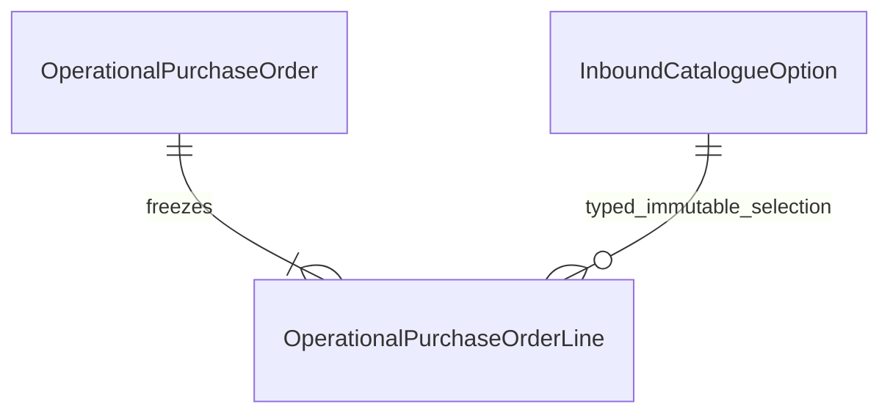

# I1 domain and data model — DRAFT / PROPOSED / NOT AUTHORIZED FOR IMPLEMENTATION

Final review baseline is local `16115d7655fb2b635165aec03b84760082194b45`; remote
status is unverified. The [focused reconciliation](I1_PURCHASE_ORDER_FINAL_REVIEW.md)
records corrections, conditional recommendations and the outstanding reference-
equivalence decision; it does not record Owner design acceptance.
[APR-034](../00-governance/approved-baselines/APR-034-i1-detailed-design.md)
authorizes detailed I1 documentation only. FACT means actual Owner policy in
[SRC-004](../00-governance/team-answers/FACTORY_PURCHASE_RECEIVING_2026-10-20.md)/
[SRC-005](../00-governance/team-answers/OWNER_I1_POLICY_CLARIFICATION_2026-10-20.md).
ARCH means existing approved architecture. Every concrete choice here is a
PROPOSED technical decision requiring Owner acceptance, not a new approved ADR.

The goal is pre-arrival operational order registration by personal ACT-PROC,
original-specification lookup by ACT-PROC/ACT-WH, and shared reference add/select
by both roles. I1 produces no received goods, stock, progress, discrepancy,
financial effect or browser UI. There is no amendment/cancellation lifecycle.
The eleven accepted backend capabilities remain unchanged.

Execution plan: reconcile mandatory sources with actual code; specify domain,
contracts, persistence/transactions, security and acceptance; independently review
and fix required findings; validate source/trace/links/diff; commit docs locally
and stop before implementation. Companion specifications:

- [API/command/query contracts](I1_PURCHASE_ORDER_API_DESIGN.md).
- [PostgreSQL, locks and transaction design](I1_PURCHASE_ORDER_DATABASE_DESIGN.md).
- [Security and narrow projections](I1_PURCHASE_ORDER_SECURITY_DESIGN.md).
- [Acceptance cases and complete 60-ID scope mapping](I1_PURCHASE_ORDER_ACCEPTANCE_PLAN.md).
- [Decision/risk log, alternatives and approval checklist](I1_PURCHASE_ORDER_DECISIONS.md).

## Code-grounded starting point

Inspected [PurchaseService](../../apps/backend/src/modules/procurement/purchase-service.ts),
[purchase contracts](../../apps/backend/src/modules/procurement/purchase-contracts.ts),
[PostgresPurchaseStore](../../apps/backend/src/infrastructure/postgresql/purchase-store.ts),
[purchase HTTP](../../apps/backend/src/transport/purchase-http.ts) and
[0015](../../database/migrations/0015_purchasing_evidence.sql). They record completed
purchase reference/supplier/date/description and optional already-sent proforma,
not operational orders/lines. Documentary references are intentionally nonunique.
Their Gregorian date parser cannot validate a Jalali business date.

Inspected [receipt contracts/parser](../../apps/backend/src/modules/procurement/receipt-service.ts),
[Inventory receipt owner](../../apps/backend/src/modules/inventory/receipt.ts),
[composition](../../apps/backend/src/composition-root.ts), [Identity authorization](../../apps/backend/src/modules/identity/authorization.ts),
[binding](../../packages/shared-kernel/src/envelope/binding.ts),
[execute](../../packages/shared-kernel/src/envelope/execute.ts),
[transaction adapter](../../apps/backend/src/infrastructure/postgresql/transaction.ts)
and related tests identified in the acceptance plan. Existing receipt creates one
Inventory Unit and uses fixed technical material classes; I1 does not extend it.
Historical [48-row analysis](PURCHASE_RECEIVING_COVERAGE_MATRIX.md) remains valid
as code evidence, with new policy in the [amendment](../02-domain-business-architecture/PURCHASE_RECEIVING_I1_POLICY_AMENDMENT.md).

## Owner boundaries and entities

Procurement is the sole write owner of the three proposed entities below. It
already owns purchase and receiving business evidence. No new master-data module,
supplier master, service, ORM or dependency is justified. Shared-kernel owns
outcomes/audit, Identity owns grants/sessions, Inventory/IPS owns stock. No I1
Inventory port or cross-owner write is introduced.

| Entity | Proposed identity and immutable facts | Consistency boundary |
| --- | --- | --- |
| OperationalPurchaseOrder | Trusted installation/factory scope; technical order UUID; exact seller reference; Jalali registration date; registered line count; original command binding and trusted creation metadata | One successful register transaction freezes header plus the complete ordered line array; no editable draft or later append operation |
| OperationalPurchaseOrderLine | Server-generated line UUID; parent order; immutable ordinal derived from input array; optional business item number; selected reference identities and original ordered scalar attributes/count/W1 | Each array member is independent even if all business values are identical; ordinal is technical display context, not seller item number |
| InboundCatalogueOption | Scoped option UUID; one of MATERIAL_TYPE, QUALITY_GRADE, COLOR; exact label; original command binding and trusted creator/time | Immutable add/select-only source; no rename/delete/merge/deactivate/reclassify command. Later lifecycle needs approved additive history rules |

The ordered attribute snapshot consists of immutable line literals plus references
to immutable catalogue rows, including their original label/kind. A lookup join is
therefore historical source reconstruction, not a join to mutable current labels.
No unvalidated client label snapshot or duplicated editable JSON truth is needed.
Any later label evolution must retain old row/meaning; it cannot rewrite past orders.

This is I1 only. Future Procurement confirmation facts may reference both order
and line IDs; no arrival/waybill/unit/receipt or mapping table is designed here.

## Factory-wide order identity

FACT: seller PO reference is factory-wide unique regardless of supplier; preserve
exact supplied text and never overwrite/merge on duplicate registration. ARCH:
[ADR-0014](../00-governance/adrs/ADR-0014-local-identity-authorization.md) and current
composition map organizational authority UUID to installation UUID for the single
legal entity/principal site. PROPOSED I1 persistence retains both scope columns,
requires authority_scope = installation_id, and enforces reference uniqueness on
installation_id plus exact reference with deterministic C collation. No role,
person, supplier, date or command key partitions that business number.

The exact-comparison branch below is PROPOSED, pending the Owner's business
equivalence decision R1 in the final review. It is not proof of semantic business
deduplication. Comparison is exact Unicode scalar/UTF-8 text identity; no trimming, case folding,
digit conversion, Unicode normalization or Persian/Arabic substitution. Source
text is returned unchanged. Nonblank text with outer spaces remains exact text,
not silently collapsed. Thus `PO-12`, ` PO-12`, case variants, Persian/Arabic digit
or letter variants and canonically equivalent Unicode sequences can all occupy
different rows. Source preservation does not decide whether these denote the same
business order. The installation-wide namespace is resolved; this equality question
is not. Exact lookup is unambiguous only among identical strings; it can miss a
variant or return a separately registered variant of the same real order.

Recommendation: accept exact identity only if the Owner explicitly confirms these
variants are distinct identifiers for I1. If variants mean the same order, retain
the original reference and design a separate agreed comparison key used identically
by UNIQUE, locks and lookup. Do not choose trim/NFC/case/digit/letter folding now.
Until that decision, the proposed exact UNIQUE prevents byte-identical duplicates
but cannot be claimed to fully enforce the confirmed business-identity rule.

Current completed-purchase/proforma UUIDs and reference strings remain separate
records with their existing rules and routes. Equal strings do not link histories.
No data conversion/backfill, new mandatory supplier field or mandatory PO retrofit
to manual receiving is part of I1. A factory/authority topology change requires
reconciliation before this single-factory mapping can be expanded.

## Exact twelve-field contract

All rows are entered by Ms. Masoumi's purchasing responsibility, implemented through
personal ACT-PROC. Technical names are proposed transport/storage translations.
The original [23-field register](../02-domain-business-architecture/PURCHASE_RECEIVING_FIELD_REGISTER.md)
is unchanged. Seven fields mandatory, five optional. Catalogue IDs represent the
selected business field, not an additional user-entered factory field.

| Factory no. / requirement | Exact Persian field | Required | Proposed I1 field / location | Value meaning and validation |
| --- | --- | --- | --- | --- |
| 2 / REQ-INBOUND-F02 | شماره سفارش | YES | orderReference / header | Exact nonblank text, factory-wide unique |
| 7 / REQ-INBOUND-F07 | شماره آیتم | NO | itemNumber / line | Optional exact nonblank business label; neither unique nor technical line key |
| 8 / REQ-INBOUND-F08 | نوع کالا | YES | materialTypeOptionId / line | UUID selecting same-scope MATERIAL_TYPE option; no technical Inventory type inference |
| 9 / REQ-INBOUND-F09 | عرض | YES | widthM / line | Exact decimal string, meters; proposed positivity/bounds below |
| 10 / REQ-INBOUND-F10 | ضخامت | YES | thicknessMm / line | Exact decimal string, millimeters; no conversion from width units |
| 11 / REQ-INBOUND-F11 | رنگ | NO | colorOptionId / line | Optional same-scope COLOR UUID; no text fallback |
| 12 / REQ-INBOUND-F12 | شماره رئال رنگ | NO | ralColorNumber / line | Optional exact nonblank text; no invented RAL pattern or dependency on Color |
| 13 / REQ-INBOUND-F13 | طول | NO | lengthM / line | Optional exact decimal string, meters |
| 14 / REQ-INBOUND-F14 | کیفیت | NO | qualityGradeOptionId / line | Optional same-scope QUALITY_GRADE UUID; no QC approval meaning |
| 15 / REQ-INBOUND-F15 | وزن | YES | unitWeightKg / line | Exact positive whole-kg string, weight of ONE physical unit, W1 |
| 16 / REQ-INBOUND-F16 | تعداد | YES | orderedUnitCount / line | Physical-unit integer count; proposed positive count, not descriptive receipt count |
| 17 / REQ-INBOUND-F17 | تاریخ ثبت سفارش | YES | registrationDateJalali / header | Explicit Jalali YYYY-MM-DD string; not a server-generated date |

Optional omission becomes SQL NULL for that optional column; output omits that
member. Explicit JSON null, blank provided text and wrong type are invalid, not
silently equivalent to omission. Registered known fields with invalid values fail
semantic validation; unknown fields fail envelope admission. The registration line
array is required technical structure and must contain 1–128 members (PROPOSED
resource bound, not ordered-unit or Inventory-effect limit).

## Numeric proposal — exact lexemes, no floating point or rounding

I1-D04 proposes text-backed exact decimal/integer domain values. Preserve accepted
numeric lexemes (including meaningful source trailing zeros) in dedicated typed
columns; DB checks validate them through guarded exact numeric comparisons. There
is no NUMERIC(p,s) coercion, floating-point column or JavaScript Number quantity.
[PostgreSQL numeric documentation](https://www.postgresql.org/docs/18/datatype-numeric.html)
explains why declared scale can round whereas unscaled numeric comparisons do not.

| Values | Proposed accepted syntax / technical bound | Domain rule / arithmetic |
| --- | --- | --- |
| widthM, thicknessMm, lengthM if present | ASCII integer part `0` or 1–20 digits without leading zero, optional dot plus 1–18 digits; at most 39 characters | Strictly positive, magnitude <10^20; preserve input string; no exponent, sign, grouping separator or implicit unit conversion |
| unitWeightKg | ASCII 1–20 digits, first digit 1–9 | Confirmed positive whole W1, <10^20 kg; BigInt for exact arithmetic |
| orderedUnitCount | Same positive integer-string syntax | PROPOSED strictly positive count, <10^20 units; not PostgreSQL bigint capacity and not old receipt's nonnegative descriptive Count |
| derived orderedLineWeightKg | Not an input field or persisted stock source | Exact Procurement-only BigInt product, at most 40 digits; a distinct derived-total type, never Inventory Kg. I1 public minimum projection omits it |

Examples are synthetic validation cases: width `1.200` round-trips unchanged;
thickness `0.35` means mm, not meters; weight `2000` and count `5` imply derived
line total `10000` but W1 remains `2000`. A 19th decimal fraction digit is rejected,
never rounded. String `NaN`, Infinity, negative/zero dimension/count, leading zeros,
numeric JSON quantities and fractional W1 reject. The 20/18 digit capacities,
positive dimensions/count and text grammar are **PROPOSED technical restrictions**,
not factory-confirmed measurement precision. Owner must accept them or identify
an actual excluded input before implementation; no new tolerance is assumed.

Capacity evidence is narrower than physical plausibility. Existing
[Kg](../../apps/backend/src/modules/inventory/quantity.ts) scales integers by10^18
and bounds the scaled magnitude below10^38; [0005](../../database/migrations/0005_inventory_posting.sql)
uses unconstrained numeric with explicit magnitude<10^20 and scale<=18 guards.
[0006](../../database/migrations/0006_goods_receipt.sql) admits positive whole receipt
kg<10^20 and nonnegative descriptive count<10^20. Thus the proposed W1 fits one
current Unit's numeric capacity; it does not resolve receiving provenance or admit
stock. Positive ordered count and dimension20/18 remain new bounded representation
proposals, not proven operating limits or factory precision.

Never cast a derived product/sum into Kg, receipt measuredKg, Ledger or Balance.
For example, individually valid W1 `10000000000000000000` and count `10` have a
derived total `100000000000000000000`, outside Kg capacity. The exact total stays
Procurement-only. No I1 requirement needs a total<10^20 restriction: multiple valid
Units may legitimately have a larger combined total. A future optional 128-line
sum needs at most43digits and its own derived-total bound. I2 must independently
validate each confirmed Unit/effect and any actual receiving-group arithmetic with
Inventory owner limits; no total or W2/W3 substitution. Do not allocate Units, loop,
reserve memory or generate records proportional to orderedUnitCount in I1.

Lexical and numeric equality are separate: `1.2` and `1.200` retain different source
strings and bind differently to a command, while exact decimal comparison yields
the same magnitude. Do not infer a discrepancy rule from that lexical difference.
Check full-string grammar/length before any BigInt/numeric parse; reject signs,
leading zeros, Persian digits, comma/slash separators, exponent, whitespace and
numeric JSON rather than silently converting. Zero is invalid even as `0.000`.
Integer operations use BigInt and JSON emits strings; no coercion through Number,
parseFloat, PG int8 or declared NUMERIC(p,s). Bounded20/18 operands make arithmetic
cost fixed per input line, not dependent on the magnitude's represented unit count.

## Jalali proposal — explicit civil date and a frozen validation profile

I1-D05 proposes ASCII `YYYY-MM-DD`, calendar always Jalali, supported years
1206–1498 inclusive. This finite technical horizon needs Owner acceptance; no
factory historical/future date limit was supplied. Do not infer a date-in-future,
order-before-today or chronology business rule.

The endpoints follow the published table's coverage, not factory age or a chosen
database type. It covers current registration and many historical dates, but the
factory's earliest required purchase date has not been established. A meaningful
1205/1499 date is unsupported, not declared an impossible Jalali date. Return a
safe durable GUARD_INVARIANT with stable `I1_DATE_OUTSIDE_PROFILE` indication and
the supported range; preserve entered input, never clamp or substitute today.
The Owner may accept this finite I1 capacity or require a reviewed wider profile
before design acceptance. No automatic calendar-range extension is proposed.

Store Jalali year/month/day as small integers plus fixed technical profile
`UT-JALALI-1206-1498-v1`. Return the exact canonical Jalali date string and
`calendar: "jalali"`. Store trusted recorded_at as independent timestamptz. Never
parse the business date with JavaScript Date, PostgreSQL DATE, timezone conversion,
Gregorian purchase evidence parser or server-today default. No Gregorian storage
or conversion is necessary for this contract; F18 arrival calendar stays unresolved.

Proposed validator: a small pure local function checks syntax/range, months 1–6
days 1–31, months 7–11 days 1–30, and Esfand 1–29 plus day 30 only in the frozen
official leap-year set. Use the University of Tehran Calendar Center's
[published 1206–1498 common/leap table](https://calendar.ut.ac.ir/documents/2139738/7092644/Kabise%2BShamsi%2B1206-1498.pdf/fbc45bf4-df46-c298-381c-2bff2c57f0e0?t=1719740029743)
as the profile source, visually verifying star/legend markings rather than relying
on PDF extraction of Gregorian columns. Future implementation must freeze the
source receipt/checksum and independently verify all 293 year flags before use.
The [official 1404 calendar](https://calendar.ut.ac.ir/documents/2139738/7092644/Calendar-1404.pdf/4321b7e0-d043-78ca-49f5-fbfc911e7901?t=1729620775906)
also explicitly identifies 1403-12-30. These are technical calendar references,
not new factory evidence or an online runtime dependency.

The table is a Calendar Center research/calculation result, not evidence that
every future civil year is already an enacted annual calendar. Treat it as a
versioned technical profile; a subsequently published authoritative conflict must
block use of the affected profile pending explicit reconciliation, not silently
rewrite historical dates. The annual1404publication independently checks a current
boundary; the complete293year vector has not been implemented or verified here.

Application and DB CHECK leap predicates must share this versioned profile and
pass exhaustive cross-checks; fail closed outside the supported range. No runtime
network/calendar lookup, extra package, timezone/ICU-version dependency or simplistic
every-four-year rule. Borkowski/Jalaali algorithm and Gregorian internal storage
were considered as alternatives, not selected; see decision log. No validation
code, leap-year fixture/data file or SQL predicate is implemented in this step.

## Catalogues, repeated lines and I2 extension

Catalogue kinds are a closed I1 technical set, while labels/options are extensible.
Both roles can add/read/select each kind. Labels use exact comparison within one
installation and kind; equal bytes in different kinds are different values. No
normalization or semantic aliasing/merge is invented. A concurrent exact duplicate
gets a durable DUP rejection; an authorized exact-label read finds the existing
option for immediate selection. Creation and order registration are separately
durable commands, not a new combined command; see API/transaction specifications.

Stable line UUID and immutable ordinal preserve missing item numbers and identical
specifications without coalescing. Future I2 must reference the returned line ID
through a Procurement owner lookup, not find a line by dimension/catalogue equality.
I1 supplies no received count/status placeholder, arrival, discrepancy marker,
physical code, weight reconciliation or posting eligibility field.

Extensible business Material Type is separate from current COIL/SHEET/ANGLE/BEAM/
OTHER. There is no technical-class column/default/mapping in I1 catalogue creation.
Later supported mapping may be additive and versioned with its own authority;
its cardinality, source/effective rules and I2 stock admission remain unresolved.
New business labels cannot silently expand enums or imply eligibility for stock.
Catalogue addition never resolves B06 unordered/excess/incorrect-goods acceptance.
